<div align="center">



</div>


### `> ID_SCAN`

```
┌─[ ID SCAN ]────────────────────────────────────┐
│                                                │
│  HANDLE    Siamesesam                          │
│  ROLE      Netrunner                           │
│  ORIGIN    Coder                               │
│  CURRENT   AI-AUGMENTED                        │
│  LINK      [||||||||||||||......] jacked in    │
│                                                │
└────────────────────────────────────────────────┘
```


### `> INSTALLED_CYBERWARE`

| SLOT | CHROME |
|:--|:--|
| `OPERATING SYSTEM` · core | ████████ `[CLASSIFIED]` |
| `OPTICS` · interface | ████████ `[CLASSIFIED]` |
| `DATAFORT` · data | ████████ `[CLASSIFIED]` |
| `SUBNET` · infra | ████████ `[CLASSIFIED]` |
| `SANDEVISTAN` · acceleration | ████████ `[CLASSIFIED]` |
| `???` · unknown | ████████ `[ENCRYPTED]` |

> `DATA ENCRYPTED // ACCESS DENIED`


<div align="center">

```
// END OF TRANSMISSION
// WAKE UP, SAMURAI. WE HAVE A CITY TO BURN.
```

</div>
